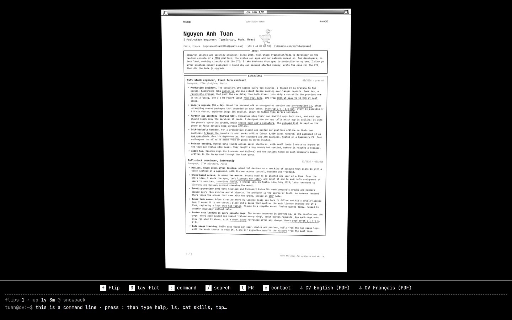

# CV as a man page



A one-page site: an A4 sheet floating in 3D that you can spin, zoom and flip, styled
like a terminal app. The sheet is a man page (`TUAN(1)`) in a black-and-white classic
Macintosh window. Under it, a key bar and a shell-like status line show tips, counters
and the explanation behind every dotted word.

Content is Markdown. The build turns it into a single static `dist/index.html`.
No dependencies, no bundler, no framework. One font: JetBrains Mono.

## Controls

| Input | Effect |
|---|---|
| Drag | turn the sheet (when zoomed in: move it; hold Shift to turn instead) |
| Scroll, pinch, `+` / `-` | zoom, anchored under the cursor |
| Arrow keys | turn (when zoomed in: pan) |
| `f`, Space, double-click | flip to the other face |
| `0`, or the window's zoom box | lay flat: face on, back to the fitted size |
| `c` | contact (opens the mail app) |
| `/` | search the sheet, like in `man`: matches highlight as you type, Enter jumps |
| `n` / `N` | next / previous match (zooms onto it, flipping the sheet if needed); while a search has matches the key bar shows prev / next / clear buttons, for phones |
| `:` (or the `[:] command` key, Enter, or a click on the status line) | type a command (see below); typing a letter without `:` shows how |
| `l` | switch language (EN ⇄ FR) |
| `p` | print |
| Hover / focus / tap a dotted word | its explanation appears in the status line; ASCII charts type themselves out |
| `Esc` | clear the tip and the search |

Browser shortcuts (Ctrl/Cmd + anything) are left alone.

The status line's default text says it is a command line (press `:`); other tips
alternate with it.

**Easter egg, not advertised on the page:** two flips within 0.7 s (`f` `f`, or the flip
button twice), or a hard fling by mouse (600° inside a second, which an ordinary drag never
reaches), is a **dyno**: the sheet spins 720° while an ASCII climber goes up
a wall as tall as the screen, hold to hold, and tops out. The `dyno` command does it too,
but `help` doesn't list it.

The status line also counts flips and dynos (kept in `localStorage`). They count what the
sheet does, not which key was pressed: every time the other face comes round is a flip
(key, drag, search, `cd`…), and dynos are counted however they're triggered. It shows a live
"uptime" since the current job started. Idle tips rotate in it every few seconds.

## The shell

The status line is a small shell. Tab completes, ↑/↓ walk the history, Esc leaves.

| Command | Does |
|---|---|
| `help` | list the commands |
| `whoami` | name and role |
| `ls` | sections and PDFs; inside a section (after `cd`), its files: entries named after the role or project (with their dates), one file per skill / interest row, `profile.txt` for About. `ls <section>`, `ls ..` work anywhere, and the view follows what is listed (the prompt stays put) |
| `cd <section>` | go into that section: the sheet turns and zooms onto it, its box flashes, and the prompt becomes `tuan@cv:~/experience$` (`experience`, `experience/`, `../skills`, `~/skills`, `/home/tuan/cv/skills` all work) |
| `cd ..`, `cd ~`, `cd` | back to the whole page, laid flat (so does `0`) |
| `cat <file>` | read one item: the sheet zooms onto it and the status line prints it (`cat full-stack-engineer` inside experience, `cat ~/skills/backend`, `cat ../projects/appius`, `cat about/profile.txt`); on a section: `Is a directory` |
| `grep <word>` | same as `/` search |
| `open <file.pdf>` | download a PDF (sections are directories: `open about` says to use `cd about`) |
| `man tuan` | back to the front page |
| `flip`, `lang en\|fr`, `contact`, `print`, `uptime`, `clear` | what they say |
| `sudo hire tuan` | try it |

Plus the usual suspects (`pwd` shows the section you're in, `echo`, `date`, `uname`, `exit`, `rm`, `vim`), each with
a one-line answer. Commands live in `COMMANDS` in `src/sheet.js`; add one by adding a key.

The sheet works as a small filesystem: sections are directories, and their items are files.
File names come from the sheet itself (role or project name before the first comma, or the
row label), so the French sheet has French names (`ingenieur-full-stack`, `langages`).
Tab completes commands, sections, and files inside a section (`cat skills/ba` → `skills/backend`).

## Languages

`content/*.md` is the English sheet. A folder named with a two-letter code holds a
translation of the same two faces: `content/fr/01-front.md`, `content/fr/02-back.md`.
Every language is built into the page; only one is shown and measured at a time.

- The `[l]` key and the `lang` command switch; the choice is remembered.
- `?lang=fr` in the URL opens the French sheet directly (handy for a French recruiter).
- Translated sections should keep the English key, so `cd skills` works in both:
  `## Compétences {grid #skills}`.
- Tips in `site.json` take a French twin: `"tip": "…", "tipFr": "…"`.
- The shell itself stays in English. It's a terminal.

## Portrait

`"portrait": "portrait.txt"` in `content/site.json` points at a plain-text ASCII picture in
`content/`. It is printed just left of the name on the front page, small (a quarter of the
body size), so it reads as a picture at normal zoom and as characters up close.
`portraitTip` / `portraitTipFr` set its status-line tip. Today it is the GitHub avatar
(the goose), drawn as outline `#`, fill `:`, beak and feet `%`, knife `=`, eye `@`.
Any text file works; keep it near 36×25 characters so the header doesn't grow.

## Edit

| Want to change | File |
|---|---|
| Any CV text | `content/01-front.md`, `content/02-back.md` |
| Name, contact row, page title, description, OG image URL | `content/site.json` |
| Man-page header (`TUAN(1)  Curriculum Vitae  TUAN(1)`) | `content/site.json` → `man` |
| Uptime counter in the status line | `content/site.json` → `uptime` |
| Download buttons and the PDFs they serve | `content/site.json` + the PDF files in `content/` |
| Link preview image (1200×630) | `content/og.png` |
| Colours, type, spacing, window frame | `src/style.css` |
| French sheet | `content/fr/01-front.md`, `content/fr/02-back.md` |
| ASCII portrait next to the name | `content/portrait.txt` (+ `portrait` in `content/site.json`) |
| Spin / zoom / flip, key bar, status line, shell, search, the dyno | `src/sheet.js` |
| HTML shell, key bar buttons, meta tags | `src/template.html` |
| Markdown → HTML | `src/build.mjs` |

```bash
npm run build   # -> dist/index.html
npm run dev     # rebuild on every save, then reload dist/index.html
```

`dist/` is generated and git-ignored. CI rebuilds it on every push to `main`.

## Markdown grammar

```md
---
title: [Nguyen Anh Tuan]       # each item is one line of the big heading
role: Full-stack engineer      # line under the name, printed as "$ Full-stack engineer"
contact: true                  # print the contact row from site.json, as [links]
# stamp: [Available, Nov 2026] # round mark; delete or # it out to remove
# stampTip: Contract ends October 2026.
sign: Turn the page.           # small italic note, bottom right
---

## About {text}                # paragraphs

Free prose here.

## Experience                  # default: entries (key: "experience")

### Role title | 05/2026 - present
Organisation, city             # first line after the heading = the italic line

- bullet
- bullet

## Skills {grid}               # label: value rows
## Compétences {grid #skills}  # kind and key together: key names it for `cd`

- Backend: Node.js, Express
```

Every `##` section is drawn as a TUI box with its name centred in the top border.
Bullets are `*`, as in a man page.

Inline, in any text:

| Syntax | Result |
|---|---|
| `{{term\|explanation}}` | dotted term; the explanation shows in the status line |
| `[label](https://…)` | link |
| `**bold**`, `*italic*` | bold, italic |

Tips can hold small ASCII charts, which read well in the monospace status line:

```md
{{Start-up 2.5 → 1.5 min|start-up time: before ██████████ 2.5 min → after ██████ 1.5 min}}
```

## site.json

```json
{
  "title": "Nguyen Anh Tuan, Full-stack engineer",
  "description": "A CV you can spin. TypeScript, Node, React. Paris.",
  "ogImage": "https://UNtergas.github.io/og.png",
  "contact": [
    { "text": "Paris, France", "tip": "On site in Paris, or remote across Europe." },
    { "text": "me@example.com", "href": "mailto:me@example.com" }
  ],
  "downloads": [
    { "label": "CV English (PDF)", "file": "cv-en.pdf", "tip": "The printable one-pager." }
  ],
  "man": ["TUAN(1)", "Curriculum Vitae"],
  "uptime": { "since": "2025-02", "until": "", "label": "snowpack" },
  "portrait": "portrait.txt",
  "portraitTip": "Honk. My GitHub avatar, in ASCII."
}
```

- `contact`: the first `mailto:` entry is also the target of the `[c] contact` key.
- `man`: left/right label and centre label of the man-page header. Remove it to hide the header.
- `uptime`: `since` is `YYYY-MM`. Set `until` when the job ends and the counter freezes.
  Remove the key to hide it.

## Downloads

The buttons serve real files, never a print of the 3D page.
Put the PDFs named in `downloads` in `content/`; every `.pdf` there is copied to `dist/`.
Links get a `?v=<content hash>` suffix, so a new PDF is never served from a stale cache.
A button whose file is missing is dropped from the page, with a warning in the build log,
so a recruiter never hits a 404.

## Sizing

A sheet has two faces, so `content/` holds two `.md` files; more are ignored with a
warning. Type auto-shrinks from 16px down to 8.5px until a page fits its margins, so bullets
can be added freely. If text still overflows, that page is genuinely too long: cut it.

Margins are fixed at 74 / 84 / 112 px of a 720×1018 sheet and scale with it, so they stay
proportional at every zoom level. The 112px bottom band holds the page number and the
sign-off line, which is why body text never reaches the paper edge.

Zoom changes the sheet's width, height and font size, not a CSS `scale()`, so the
browser re-renders the type at each step instead of stretching pixels. Zoom floor is the
fitted size; "lay flat" animates back to it, square on. The key bar sits below the stage,
never on top of the paper.

Printing (`p`, or Ctrl/Cmd+P) prints the current language and drops the window frame, key bar and 3D, and prints both faces as
plain pages.

## Deploy

`dist/` is a plain static folder with relative paths only, so any static host serves it.

| Host | Setup | URL |
|---|---|---|
| GitHub Pages | Settings → Pages → Source: GitHub Actions (workflow included) | `user.github.io` or `user.github.io/repo/` |
| Vercel | Import repo, config in `vercel.json` | `project.vercel.app` |
| Netlify | Import repo, config in `netlify.toml` | `project.netlify.app` |
| Cloudflare Pages | Build command `node src/build.mjs`, output `dist` | `project.pages.dev` |

Build command is the same everywhere: `node src/build.mjs`, publish `dist`.
There are no dependencies, so the install step is a no-op.

Custom domain: on GitHub Pages put a `CNAME` file in `content/` (it gets copied to `dist/`);
on the others set it in the dashboard and delete the `CNAME` file.

If the site lives under a subpath (`user.github.io/cv/`), everything still works (asset
links are relative), but set `ogImage` in `content/site.json` to the full URL including
the subpath, since Open Graph needs absolute URLs.
